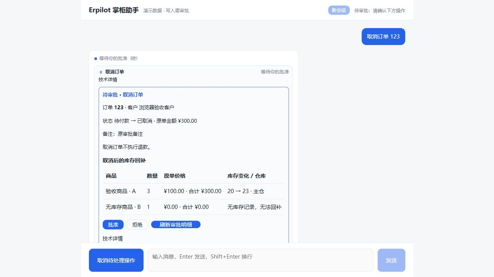
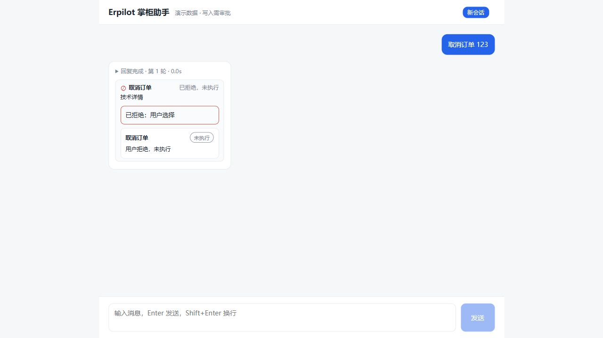

# B3 业务影响审批验收

日期：2026-10-11。范围：本机可信单用户的取消订单与库存调整，不部署。

## 已交付

- 取消前展示客户、原订单金额、状态变化、商品明细及库存回补；缺失库存记录明确提示不会回补，取消不执行退款。
- 库存调整前展示商品、仓库、增减量和数量前后；缺失库存时说明会创建库存记录。
- 预览保存不可变操作引用，30 分钟有效。审批恢复只使用原引用，订单状态、商品、库存或仓库变化后要求重新预览和审批。
- 执行在同一事务中校验快照、写入业务数据及保存结果；相同或新 token 重试同一引用均只执行一次。会话和操作类型隔离先于结果读取。
- 前端恢复、刷新和工具完成后重新核对摘要；摘要缺失、类型不符、变化、过期或已执行时禁止批准，保留拒绝入口。自定义旧工具仍可使用原审批流程。
- 成功与失败结果卡展示业务结果、原因及下一步提示；通用 agent_core 不引入 ERP 业务依赖。

## 验证证据

| 检查 | 结果 |
| --- | --- |
| 全仓 Python：`uv run pytest` | 483 passed / 21 skipped / 47 deselected |
| 静态检查：`uv run ruff check .` | All checks passed |
| 前端：`npm test` | 70 passed |
| 前端：`npm run build` | 类型检查与生产构建通过 |
| 差异检查：`git diff --check` | 通过 |
| 独立审查最终复核 | 无阻塞问题；补充定向验证 27 passed |

领域测试覆盖预览无写入、状态/库存/仓库变化、过期、缺失库存、会话和类型隔离、重复执行与并发。MCP 与 HTTP 集成覆盖真实工具协议、审批批准和拒绝、恢复、响应丢失后的结果核对。

实际浏览器使用确定性模拟数据验证取消摘要、缺失库存、无退款说明、库存调整、失效禁用批准、拒绝结果、键盘操作以及 320/768/1024/1440 宽度；未发现横向溢出或控制台错误。截图为模拟业务数据，不代表真实 ERP 写入：

审查中补充修复历史订单同 SKU 多行的累计回补展示、取消结果说明传递及自定义旧工具兼容性；均有回归验证。

## 边界与后续

本次未调用付费模型、未进行部署或线上验收。21 项可选环境测试跳过，47 项在线评测未运行；以上通过数不包含这些测试。已有评测与安全文档改动保留，不纳入 B3 提交。

下一阶段 B4：多轮结构化任务状态、历史会话入口及继续任务的恢复体验，按业务路线文档推进。
