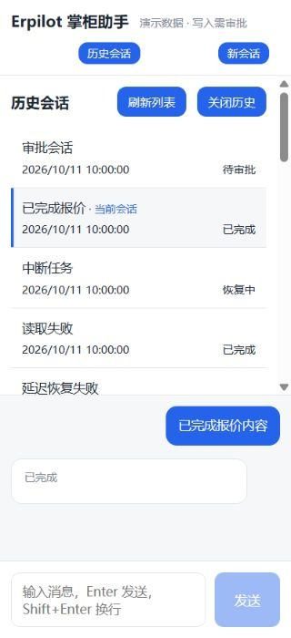

# B4 多轮任务与历史会话验收

日期：2026-10-11。本机可信单用户；未部署。

## 交付行为

新增会话绑定的 `get_order_task`，从持久化草稿读取客户、商品行、数量、备注和版本。唯一未提交草稿可继续；多份返回 ambiguous，先澄清，不能猜最新一份。超过 20 个候选显示 has_more，仍判定歧义；过期草稿保留，提交需刷新后重新审批。

`revise_order_draft_quantity` 按明确版本、1 起算行号修改数量；同一事务内校验会话归属、版本与数量，保留客户、备注和其他商品，生成不可变新版本。只保存报价，原建单审批门槛保持。每轮开始使用当前工作流提示，旧会话不会沿用旧规则；暂停中的审批恢复参数保持原值。

网页新增历史会话列表、分页、刷新与当前会话标记。可以离开待审批或中断任务并再次找回；列表与切换不取消或执行操作。当前活动任务禁止切换。恢复失败保持输入锁定。旧会话成功、失败和延迟流事件均绑定会话及请求代次，返回同一会话也不会接纳旧响应。

## 接口

- GET `/api/sessions?limit=20&offset=0`：标题取首轮输入前 80 字；返回 session_id、title、UTC Z 时间 updated_at、运行投影 status 及 has_more。limit 1~50，offset >=0；进入会话仍以 checkpoint 状态为执行事实。
- GET `/api/sessions/{id}/order-task`：返回 status、draft、candidates、has_more；草稿环境未启用返回结构化 503。
- 会话状态增加可选 order_task。MCP 两个新增工具均无模型可见 session_id，不引入 agent_core ERP 依赖。

## 验证

| 检查 | 结果 |
| --- | --- |
| 全仓 `uv run pytest` | 513 passed / 21 skipped / 47 deselected |
| `uv run ruff check .` | All checks passed |
| 前端 `npm test` | 73 passed |
| 前端 `npm run build` | 类型检查及生产构建通过 |
| `git diff --check` | 通过 |
| 独立复审 | UTC 时间修复后无剩余阻塞问题 |

领域与真实 MCP 测试覆盖无任务、唯一任务、多任务、21 个候选、过期、重建、已提交、版本冲突、会话隔离、严格整数、行号越界和并发。真实服务配合脚本客户端验证两轮查询/修改：重建宿主并恢复旧提示后，把 B 商品从 4 件改成 50 件，A 商品 3 件、客户和备注不变，没有建单或扣库存。

浏览器使用确定性模拟数据验证历史分页到末页、待审批离开并恢复、离开中断任务、恢复失败输入锁定、延迟旧错误隔离、当前选择标记、执行中禁止切换和 320px 布局。模拟服务计数：cancelled=0、mutations=0。正常页面初始控制台无错误；故意失败的恢复请求返回 503，用于验证失败锁定。

审查发现 SQLite UTC 时间缺少时区使本地显示偏差；实际 SQLite 回归先失败，统一输出 ISO UTC Z 后通过。另一个恢复回归先失败于旧系统提示，更新新轮工作流规则后通过。

## 限制与后续

没有调用付费模型，不宣称完成真实模型自然语言指代或澄清准确率评测。21 项可选环境测试跳过，47 项在线评测未运行。本阶段约束随草稿备注保留，尚无通用跨业务任务槽位引擎。已有评测及安全变更保留在工作区，未纳入本阶段提交。

下一阶段 B5：以“这张订单还能取消吗”为场景，将订单事实、政策版本与引用、确定性执行许可联动，再扩展退换货判断。
